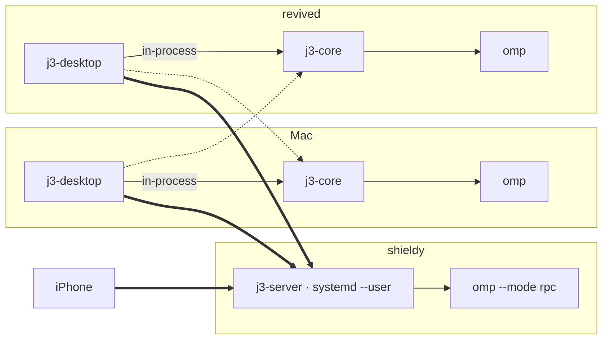

# j3code plan

j3code is a GUI for running coding agents on your own machines and driving them from desktop and phone:

- **One harness.** [Oh My Pi](https://github.com/can1357/oh-my-pi) (`omp`) is the only agent. No provider abstraction.
- **Native desktop.** The desktop client is Rust + [Rune](https://github.com/anomalyco/rune) (a GPU-rendered native UI framework), not Electron. It was first built on GPUI (Zed's UI framework) and rewritten on Rune.
- **Rust server.** The server is a Rust library embedded in the desktop app and also shipped headless (`j3-server`).
- **Native iOS.** A SwiftUI app that uses the same Rust protocol client as the desktop.

## Machines

| Host | OS | Role |
|---|---|---|
| shieldy | Debian x86_64, always on | Main agent host. `j3-server` runs as a systemd user service (linger on). |
| revolver (MacBook) | macOS arm64 | Desktop client. Its in-process server handles local threads. |
| revived | NixOS x86_64 | Desktop client. Its in-process server handles local threads. |
| iPhone | iOS | Mobile client. Connects to shieldy by default. |

All traffic goes over Tailscale. New threads go to shieldy by default. Mac↔revived connections are supported but rare.



## Decisions

| Area | Decision |
|---|---|
| Desktop toolkit | [Rune](https://github.com/anomalyco/rune) with rune-kit and its OpenCode theme (pinned `dev` rev), macOS arm64 + Linux x86_64. Replaced GPUI. |
| Desktop v1 scope | Environments (local + remote), project list, thread sidebar, streaming chat with markdown (TeX math typeset with RaTeX: `$…$`, `$$…$$`, `\(…\)`, `\[…\]`; Pandoc's dollar rule keeps prices as prose; a "Render math" setting turns it off; inline formulas in lists, quotes, headings and table cells fall back to a Unicode approximation, since rune-kit's Markdown takes no inline images there; a message sent in the open thread glides to the top of the feed and its reply writes down under it, as in the big chat apps, instead of pushing the conversation up while it streams), composer (multiline text, pasted images, omp slash commands/skills, `^model` mentions as atomic chips, `@path` file references completed like omp's editor — fuzzy over the files git doesn't ignore, `dir/` lists a directory, `/…`, `~/…` and `../…` list outside the project, all searched on the thread's host —, omp's magic keywords glowing like the TUI draws them, omp's native word prediction as ghost text after the caret — Tab takes the word with a provisional space, → without one, as in omp's editor — and a microphone button left of Send for on-device dictation into the draft), model + thinking picker (with starred favourites; models show their display names, never raw ids, and names that collide get a provider or id-token qualifier), queue/steer/stop (one send button: send, queue or stop; messages sent into a run queue, and the queue panel steers them), omp `ask` dialogs, todos, goals, subagent visibility. Tool calls are drawn the way omp's TUI draws them (per-tool icon and title, framed command/diff/match previews that expand in place, code syntax-coloured by file type with rune-kit's highlighter — Rust, JavaScript/TypeScript, JSON, Python, Go, Swift, shell, SQL, HTML/XML, CSS and YAML; other languages stay plain —, commands as bash, JSON input as JSON); images a tool returns show under its row. Markdown images load from the web, `data:` URLs, or as files on the thread's host. Magic keywords (`ultrathink`, `orchestrate`, `workflowz`, `jevify`), `^provider/model` mentions and `@path` references need no further server support: the composer text goes to omp verbatim and omp adds its hidden notices, expands mentions and reads referenced files itself; the desktop only draws them (gradient words, model chips in the composer and in sent messages). No diffs in v1. Git control (commit, push, pull, GitHub pull requests through the host's `gh`) followed, then a per-thread terminal drawer (⌃\`) and a file pane (the project's tree and a read-only file preview, ⌘⇧E), both running on the thread's host. Alert sounds are j3's own and play only while the window is in the background. Colored SVGs (provider logos, formulas) are rasterized at device resolution, so they stay sharp at 1x and 2x. |
| Server | Rust. `j3-core` is the server library; `j3-server` is the headless binary. No UI dependency on the server side. |
| Server scope | Projects, threads, and omp orchestration. One small remote directory listing endpoint, so clients can add a project on a remote host. For the terminal drawer and file pane: PTY shells per thread (`terminal.*`) and project file listing and reading (`projects.listEntries`, `projects.readFile`). For the composer's `@path` completion: `projects.searchEntries` (a gitignore-aware walk of the project, reused for 10 s). |
| Persistence | omp's session `.jsonl` stays the source of truth for the conversation. j3's SQLite (versioned with `user_version` and ordered migrations) stores projects, the thread index (thread id → omp session file, project, title, triage state), and each thread's turns, items, requests and queue, together with a monotonic `sequence` that survives restarts. Migration 2 rebuilt the conversation of every existing thread from its omp session file. |
| Live turns | Turns keep running with no client attached. Clients that reconnect get a projection snapshot followed by sequenced deltas. |
| Harness | `omp --mode rpc --approval-mode=yolo`, one process per active thread, the user's real `~/.omp/agent` config (models, auth, extensions, skills, MCP). `set_ask_dialog` is on, so the `ask` tool reaches clients. |
| CLI interop | One-way. App threads are normal omp sessions in omp's default session directory, so `omp --resume` in the project lists them. TUI sessions are not imported into the app. |
| Credentials | Per machine: each server uses that machine's omp logins, and clients show each environment's own model list. |
| Auth | None. Servers listen only on `127.0.0.1` and the host's Tailscale IP; tailnet ACLs are the boundary. |
| Wire protocol | j3's own protocol (`docs/protocol/wire.md`): JSON over one WebSocket with request/response, credit-gated streams and `{code, message, data}` errors; discovery at `GET /api/v1/info`. Rust types live in `j3-protocol`. Desktop and iOS share one client (`j3-client`), so a protocol change breaks both at compile time. |
| iOS | SwiftUI app (`apps/ios`) over `j3-client` through UniFFI (`crates/j3-mobile`); feed rendered in SwiftUI from Rust-prepared text and RaTeX math. Free personal team, bundle id `dev.jacobyuill.j3code`, re-signed every 7 days. |
| Repo | Monorepo, Rust plus the Swift app. History kept (`docs/m8.md` D7). |
| License | MIT. omp's MIT `omp-rpc` crate is a git dependency. |
| Build | Cargo workspace. A Nix flake provides the dev shell and packages for shieldy/revived; the Mac uses rustup and XcodeGen for the iOS app. |

## Layout

```
crates/
  j3-protocol/      client⇄server wire types (`docs/protocol/wire.md`)
  j3-core/          server library: omp driver, engine (thread actors, omp → j3 entities), SQLite store, hub, HTTP/WS
  j3-server/        headless binary (`j3-server serve [--tailscale]`), port 3780
  j3-client/        protocol client: connection supervisor, typed calls, shell/thread/inbox state (UI-agnostic)
  j3-text/          message text preparation (math, keywords, mentions), shared by desktop and iOS
  j3-mobile/        UniFFI bindings over j3-client and j3-text; staticlib → XCFramework
  j3-desktop/       Rune desktop app (binary `j3`); embeds j3-core as the local environment
apps/ios/           SwiftUI app; project.yml (XcodeGen)
docs/protocol/      the wire protocol
contrib/            systemd unit, macOS bundler, iOS XCFramework build, provenance check
```

Protocol check against a running server with a real omp (spends tokens): the `#[ignore]`d live test in `crates/j3-core/tests/omp_live.rs`.

## omp integration

- Driver: the official `omp-rpc` Rust client (`can1357/oh-my-pi`, `sdk/rust/omp-rpc`), pinned by git revision. Its `wire.rs` is generated from omp's RPC schema, so it tracks omp's protocol exactly, including the v2 chunked framing.
- Process per thread: started with `--mode rpc --approval-mode=yolo` and `cwd` = project directory. To resume, `--session <file>` is added. The process exits when the thread goes idle beyond a timeout and is started again on demand.
- Identity: after start, `get_state` reports `sessionId`/`sessionFile`, which go into the thread index.
- `ask`/`select`/`confirm`/`input`/`editor` requests become pending thread requests that any connected client can answer. The response is written back as `extension_ui_response`.
- A run is finished at `session_settled`, not `agent_end`, because background jobs can wake the agent after it yields.
- Git: the desktop's generated commits run `omp commit` in the project (omp's `commit` model role, changelog updates, split commits); pull request text is a one-shot `omp -p` on `pi/commit`, then `pi/smol`, then `pi/default`.
- Composer assist: word prediction (`predict_word`, `predict_word_feedback`) runs on one `omp --mode rpc --no-session` of the desktop's own machine, whichever environment the thread is on, so a prediction per keystroke stays off the network. It starts when a composer first takes focus, with no tools (so no MCP servers), skills, rules, context files or extensions. `spelling.autocomplete: off` turns prediction off. Predictions go out one at a time, newest wins: concurrent calls could reach omp out of order, and omp answers all but the last one it receives with `null`.
- Dictation does not use omp. The desktop records its own machine's microphone (cpal) and transcribes it with whisper.cpp (`whisper-rs`; Metal on macOS, Vulkan on Linux), English only. The microphone opens the moment the button is pressed and records until 300 ms after it is pressed again, while the model downloads (whisper.cpp's GGML files from Hugging Face, SHA-256 checked, into `<data dir>/j3/models`) and loads; nothing said in the meantime is lost. While recording, the whole recording is re-transcribed greedily whenever the last pass is done, as feedback in the draft; the final text is one beam-search pass over all of it. Settings > Dictation picks the model; by default Large v3 Turbo on a GPU, Small on a CPU with 8+ threads, Base otherwise.

## Milestones

| # | Milestone | Done when | Status |
|---|---|---|---|
| M0 | Repo skeleton, flake, plan | `cargo test` passes on Mac and on shieldy (`nix develop`). | done |
| M1 | omp driver (`j3-core::omp`) | Integration test starts real omp, prompts, streams events, answers `ask`, resumes by session file, on Mac and shieldy. | done (`crates/j3-core/tests/omp_live.rs`) |
| M2 | Wire protocol foundations | Effect RPC envelope types round-trip frames captured from Effect's own RPC server; iOS thread-surface spec written. | done; superseded by M8 |
| M3 | Server | `j3-server serve` on shieldy under systemd; thread create/prompt/stream/reconnect over WS, verified with a scripted client. | done: user unit on shieldy, port 3780; conformance 37/37 on Mac and shieldy |
| M4a | Desktop v1 core | GPUI app on Mac: local + shieldy environments; projects, threads, streaming chat, composer (images, model/thinking, slash commands/skills), steer/queue/stop, `ask` answers, todos. | built; 26 tests incl. 7 headless UI tests against a real server. Outstanding: interactive smoke on the Mac (screen was locked) |
| M4b | omp extras | Goals and subagent visibility end to end, safe for the iOS client. | done: goals on t3's provider-thread `goal`, subagents as t3 `subagent` entities/items, `j3.goal.*` commands; superseded by M8 <!-- deny-list: allow --> |
| M5 | iOS | Trimmed Expo app on the iPhone, talking to shieldy. | done; replaced by the SwiftUI app in M8 |
| M6 | revived | Linux desktop build and NixOS packaging verified on revived. | done: `.#j3-desktop` (binary, `dev.jacobyuill.j3code` desktop entry and icon) renders as a native Wayland window on revived's AMD GPU; installed system-wide from the `j3code` input of revived's `/etc/nixos` flake |
| M7 | Desktop on Rune | The desktop app rewritten from GPUI onto Rune + rune-kit with the same behaviour, and the headless UI tests ported. | built on branch `rune-desktop`: every surface rewritten, offline `--scene` fixtures for headless snapshots, 22 UI tests against a real server with a scripted omp; the Nix package builds and runs as a native Wayland window on revived. Outstanding: a macOS build and interactive smoke on the Mac |
| M8 | j3-owned protocol and native iOS | No upstream-derived code, wire names or notices remain; iOS rebuilt as SwiftUI over `j3-client` (UniFFI) on a j3-owned protocol. Plan and record: [`docs/m8.md`](docs/m8.md). | see `docs/m8.md` Status |
