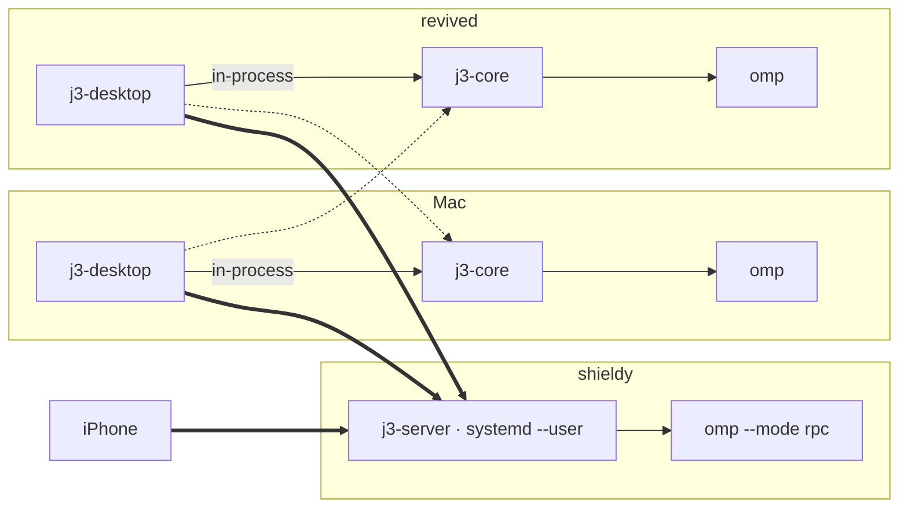

# j3code plan

j3code is a personal take on [t3code](https://github.com/pingdotgg/t3code): a GUI for running coding agents on your machines and driving them from desktop and phone. It differs from t3code in three ways:

- **One harness.** [Oh My Pi](https://github.com/can1357/oh-my-pi) (`omp`) is the only agent. No provider abstraction.
- **Native desktop.** The desktop client is Rust + GPUI (Zed's UI framework), not Electron.
- **Rust server.** The server is a Rust library embedded in the desktop app and also shipped headless (`j3-server`). The iOS app is a trimmed fork of t3code's Expo app, kept wire-compatible with the server.

## Machines

| Host | OS | Role |
|---|---|---|
| shieldy | Debian x86_64, always on | Main agent host. `j3-server` runs as a systemd user service (linger on). |
| revolver (MacBook) | macOS arm64 | Desktop client. Its in-process server handles local threads. |
| revived | NixOS x86_64 | Desktop client. Its in-process server handles local threads. |
| iPhone | iOS | Mobile client. Connects to shieldy by default. |

All traffic goes over Tailscale. New threads go to shieldy by default. Mac↔revived connections are supported but rare.



## Decisions

| Area | Decision |
|---|---|
| Desktop toolkit | GPUI, macOS arm64 + Linux x86_64. |
| Desktop v1 scope | Environments (local + remote), project list, thread sidebar, streaming chat with markdown, composer (multiline text, pasted images, omp slash commands/skills, `^model` mentions as atomic chips, omp's magic keywords glowing like the TUI draws them), model + thinking picker (with starred favourites), queue/steer/stop (one send button: send, queue or stop; messages sent into a run queue, and the queue panel steers them), omp `ask` dialogs, todos, goals, subagent visibility. Tool calls are drawn the way omp's TUI draws them (per-tool icon and title, framed command/diff/match previews that expand in place); images a tool returns show under its row. Markdown images load from the web, `data:` URLs, or as files on the thread's host. Magic keywords (`ultrathink`, `orchestrate`, `workflowz`, `jevify`) and `^provider/model` mentions need no server support: the composer text goes to omp verbatim and omp adds its hidden notices and expands mentions itself; the desktop only draws them (gradient words, model chips in the composer and in sent messages). No diffs in v1. Git control (commit, push, pull, GitHub pull requests through the host's `gh`) followed, then a per-thread terminal drawer (t3's, ⌃\`) and a file pane (the project's tree and a read-only file preview, ⌘⇧E), both running on the thread's host. Alert sounds are j3's own and play only while the window is in the background. |
| Server | Rust. `j3-core` is the server library; `j3-server` is the headless binary. No GPUI dependency on the server side. |
| Server scope | Projects, threads, and omp orchestration. One small remote directory listing endpoint, so clients can add a project on a remote host. For the terminal drawer and file pane: PTY shells per thread (`terminal.*`) and project file listing and reading (`projects.listEntries`, `projects.readFile`). |
| Persistence | omp's session `.jsonl` stays the source of truth for the conversation. j3's SQLite stores the project/thread index (thread id → omp session file, project, title, status), settings, and the t3-shaped thread projections the iOS client decodes, together with a monotonic event `sequence` that survives restarts (`docs/protocol/ios-surface.md`). No event log or replay: projections are updated in place from omp events. |
| Live turns | Turns keep running with no client attached. Clients that reconnect get a projection snapshot followed by sequenced deltas. |
| Harness | `omp --mode rpc --approval-mode=yolo`, one process per active thread, the user's real `~/.omp/agent` config (models, auth, extensions, skills, MCP). `set_ask_dialog` is on, so the `ask` tool reaches clients. |
| CLI interop | One-way. App threads are normal omp sessions in omp's default session directory, so `omp --resume` in the project lists them. TUI sessions are not imported into the app. |
| Credentials | Per machine: each server uses that machine's omp logins, and clients show each environment's own model list. |
| Auth | None. Servers listen only on `127.0.0.1` and the host's Tailscale IP; tailnet ACLs are the boundary. The client still checks scopes locally, so `/api/auth/session` returns a constant all-scopes session, and the forked client-runtime skips pairing and websocket tickets. |
| Wire protocol | WebSocket using t3code's Effect RPC JSON message format, cut down to the methods the trimmed iOS app calls. Rust types live in `j3-protocol`. We own the protocol; server and iOS change together. |
| iOS | Trimmed fork of `t3code/apps/mobile`: threads, chat, composer, `ask` dialogs. Removed: Android, Clerk, T3 relay/Connect, push, widgets, share extension, Axiom telemetry, EAS/OTA. Free personal team, bundle id `dev.jacobyuill.j3code`, re-signed every 7 days. |
| Repo | Monorepo. t3code is imported as a snapshot commit (upstream SHA in `NOTICE`), not as history. No upstream sync. |
| License | GPL-3.0. t3code's MIT notice is kept in `NOTICE`. omp's MIT `omp-rpc` crate is a git dependency. |
| Build | Cargo workspace. A Nix flake provides the dev shell and packages for shieldy/revived; the Mac uses rustup. |

## Layout

```
crates/
  j3-protocol/      client⇄server wire: Effect RPC envelopes (`effect_rpc`) + t3 contract types (`t3`)
  j3-core/          server library: omp driver, engine (thread actors, omp→t3 mapping), SQLite store, hub, HTTP/WS
  j3-server/        headless binary (`j3-server serve [--tailscale]`), port 3780 (t3code keeps 3773)
  j3-client/        protocol client: connection supervisor, typed calls, shell/thread state reducers (GPUI-agnostic)
  j3-desktop/       GPUI Kit desktop app (binary `j3`); embeds j3-core as the local environment
packages/contracts/ t3code's Effect Schema contracts (unchanged copy); used by the conformance client and later the iOS app
tests/conformance/  Node client that drives a j3 server like t3's client-runtime and decodes everything with the contracts
apps/mobile/        trimmed Expo fork of t3code/apps/mobile                [M5]
docs/protocol/      wire format notes captured from t3code
contrib/systemd/    user unit for j3-server
```

Protocol check against a running server (uses real omp and spends tokens):
`cd tests/conformance && pnpm conformance --url http://127.0.0.1:3780 --model <provider/id> --project <dir on that host>` (after `pnpm install` at the root).

## omp integration

- Driver: the official `omp-rpc` Rust client (`can1357/oh-my-pi`, `sdk/rust/omp-rpc`), pinned by git revision. Its `wire.rs` is generated from omp's RPC schema, so it tracks omp's protocol exactly, including the v2 chunked framing.
- Process per thread: started with `--mode rpc --approval-mode=yolo` and `cwd` = project directory. To resume, `--session <file>` is added. The process exits when the thread goes idle beyond a timeout and is started again on demand.
- Identity: after start, `get_state` reports `sessionId`/`sessionFile`, which go into the thread index.
- `ask`/`select`/`confirm`/`input`/`editor` requests become pending thread requests that any connected client can answer. The response is written back as `extension_ui_response`.
- A run is finished at `session_settled`, not `agent_end`, because background jobs can wake the agent after it yields.
- Git: the desktop's generated commits run `omp commit` in the project (omp's `commit` model role, changelog updates, split commits); pull request text is a one-shot `omp -p` on `pi/commit`, then `pi/smol`, then `pi/default`.

## Milestones

| # | Milestone | Done when | Status |
|---|---|---|---|
| M0 | Repo skeleton, flake, plan | `cargo test` passes on Mac and on shieldy (`nix develop`). | done |
| M1 | omp driver (`j3-core::omp`) | Integration test starts real omp, prompts, streams events, answers `ask`, resumes by session file, on Mac and shieldy. | done (`crates/j3-core/tests/omp_live.rs`) |
| M2 | Wire protocol foundations | Effect RPC envelope types round-trip frames captured from Effect's own RPC server; iOS thread-surface spec written. | done (`docs/protocol/`) |
| M3 | Server | `j3-server serve` on shieldy under systemd; thread create/prompt/stream/reconnect over WS, verified with a scripted client. | done: user unit on shieldy, port 3780; conformance 37/37 on Mac and shieldy |
| M4a | Desktop v1 core | GPUI app on Mac: local + shieldy environments; projects, threads, streaming chat, composer (images, model/thinking, slash commands/skills), steer/queue/stop, `ask` answers, todos. | built; 26 tests incl. 7 headless UI tests against a real server. Outstanding: interactive smoke on the Mac (screen was locked) |
| M4b | omp extras | Goals and subagent visibility end to end, safe for the iOS client. | done: goals on t3's provider-thread `goal`, subagents as t3 `subagent` entities/items, `j3.goal.*` commands (`docs/protocol/j3-extensions.md`) |
| M5 | iOS | Trimmed Expo app on the iPhone, talking to shieldy. | simulator Release run driven end to end; installed on the iPhone (launch needs the developer profile trusted on the phone; free-team profile expires every 7 days). Known gaps: todo row expands to raw JSON, archived-thread subtitle shows a branch icon |
| M6 | revived | Linux desktop build and NixOS packaging verified on revived. | done: `.#j3-desktop` (binary, `dev.jacobyuill.j3code` desktop entry and icon) renders as a native Wayland window on revived's AMD GPU; installed system-wide from the `j3code` input of revived's `/etc/nixos` flake |
