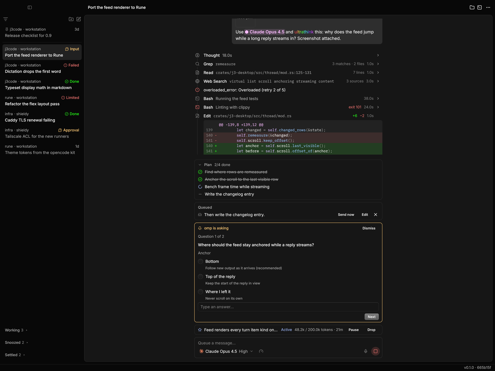
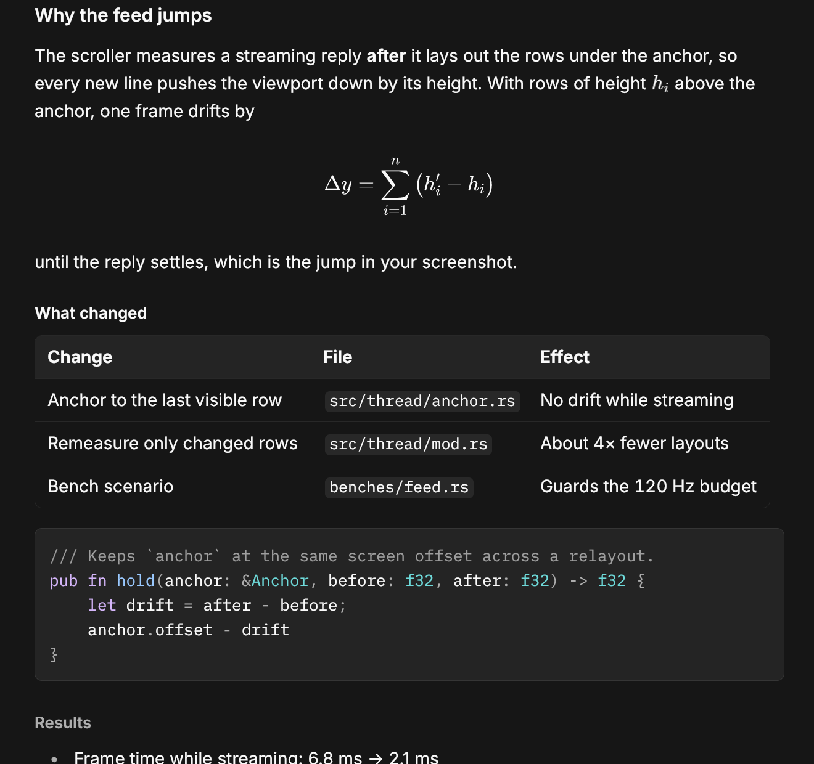
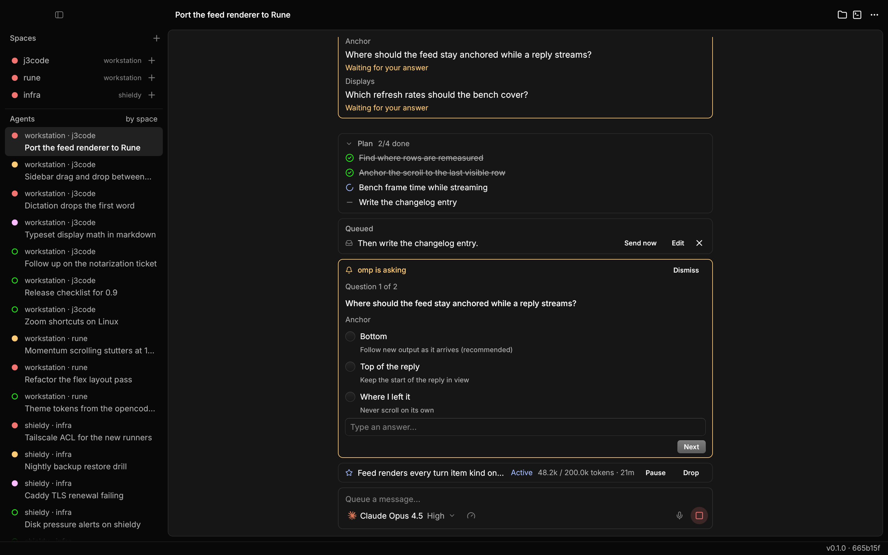
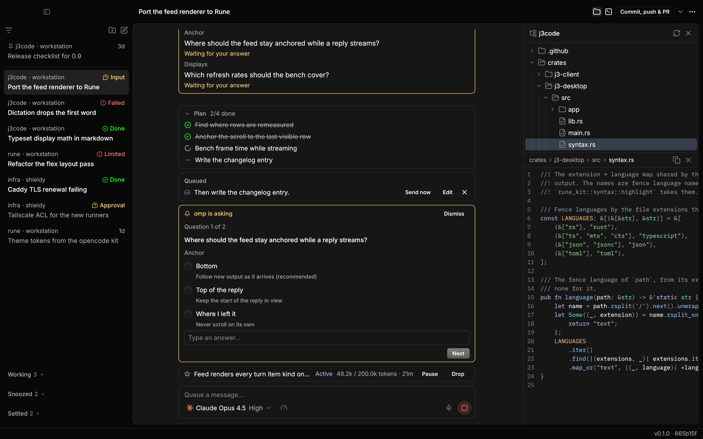
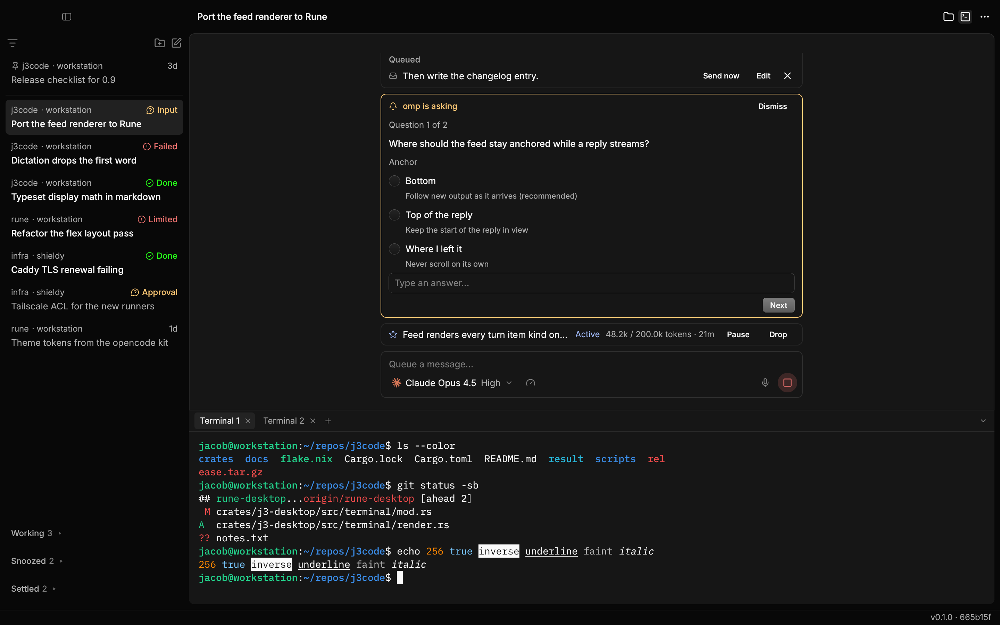
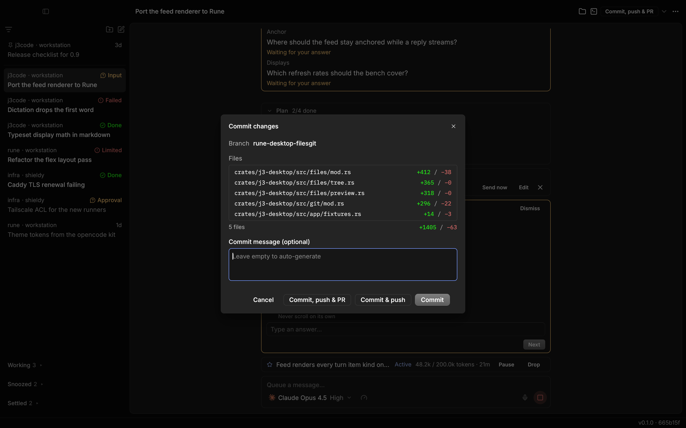
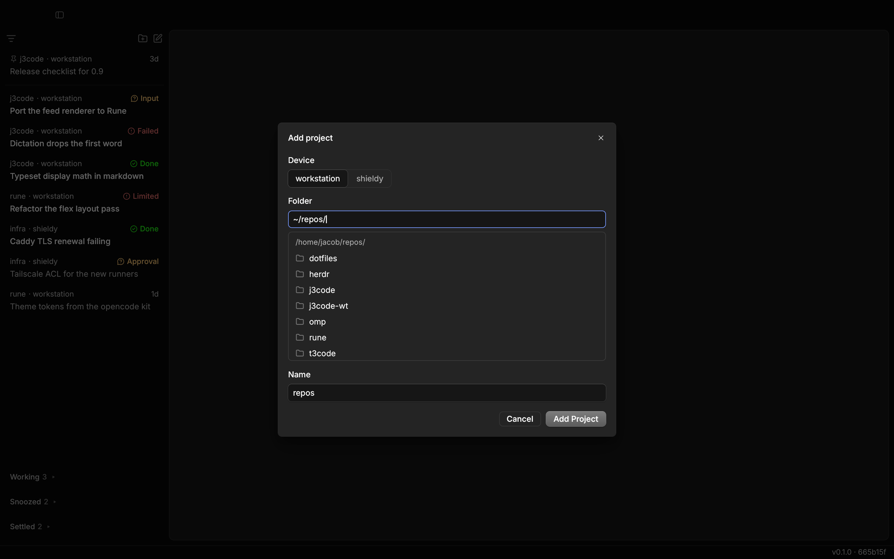

# j3code

A native desktop and mobile client for running [Oh My Pi](https://github.com/can1357/oh-my-pi) (`omp`) coding agents on your own machines.

<picture>
  <source media="(prefers-color-scheme: light)" srcset="docs/screenshots/thread-light.png">
  
</picture>

- **One agent.** `omp` is the only harness. Threads are ordinary omp sessions, so `omp --resume` sees them.
- **Native desktop.** Rust + [Rune](https://github.com/anomalyco/rune), not Electron. macOS (arm64) and Linux (x86_64).
- **Rust server.** `j3-core` is embedded in the desktop app and also ships headless as `j3-server`.
- **iOS client.** A trimmed Expo app that talks to the same server.

Forked from [t3code](https://github.com/pingdotgg/t3code). See [PLAN.md](PLAN.md) for design decisions and [docs/protocol](docs/protocol) for the wire format.

## Screenshots

<table>
  <tr>
    <td width="50%"></td>
    <td width="50%"></td>
  </tr>
  <tr>
    <td><b>Replies</b>: streaming Markdown with math, tables and syntax-highlighted code.</td>
    <td><b>herdr workflow</b>: every agent on every machine, grouped by space or by what it needs from you.</td>
  </tr>
  <tr>
    <td></td>
    <td></td>
  </tr>
  <tr>
    <td><b>Files</b>: browse and preview the thread's workspace.</td>
    <td><b>Terminal</b>: a shell in the workspace, in a drawer under the thread.</td>
  </tr>
  <tr>
    <td></td>
    <td></td>
  </tr>
  <tr>
    <td><b>Git</b>: commit, push and open a PR from the thread.</td>
    <td><b>Multiple machines</b>: add projects on this computer or any j3 server on your tailnet.</td>
  </tr>
</table>

Screenshots are rendered headlessly from the offline fixture scenes in `crates/j3-desktop/src/app/fixtures.rs` (see [CONTRIBUTING.md](CONTRIBUTING.md)).

## Layout

| Path | Contents |
|---|---|
| `crates/j3-protocol` | Wire types: Effect RPC envelopes and t3 contract types |
| `crates/j3-core` | Server library: omp driver, thread engine, SQLite store, HTTP/WebSocket |
| `crates/j3-server` | Headless server binary |
| `crates/j3-client` | Protocol client and state reducers (UI-agnostic) |
| `crates/j3-desktop` | Rune desktop app (binary `j3`) |
| `apps/mobile` | iOS app |
| `packages/`, `tests/conformance` | Shared TypeScript packages and a protocol conformance client |
| `contrib/` | systemd unit, macOS app bundler |

## Requirements

- [`omp`](https://github.com/can1357/oh-my-pi) installed and logged in on every machine that runs agents
- Rust 1.88+ and CMake (the desktop builds whisper.cpp for dictation)
- Linux desktop builds: `pkg-config`, `glslc`, and the GUI and audio libraries listed in [`ci.yml`](.github/workflows/ci.yml)
- Optional: Nix (`nix develop`, or direnv via `.envrc`, provides the toolchain, the mold linker and libraries), Node 26 + pnpm for the TypeScript packages

## Build and run

```sh
cargo run --release -p j3-desktop        # desktop app
cargo run --release -p j3-server -- serve   # headless server (default port 3780)
```

With Nix: `nix run .#j3-server`, or `nix build .#j3-desktop` on Linux.

macOS app bundle: `contrib/macos/bundle.sh`.

### Headless server

`j3-server serve --tailscale` listens on `127.0.0.1` and this host's Tailscale address. There is no authentication; restrict access with tailnet ACLs. To run it as a systemd user service, see [`contrib/systemd/j3-server.service`](contrib/systemd/j3-server.service).

### iOS

See [`apps/mobile/README.md`](apps/mobile/README.md).

## Test

```sh
cargo test --workspace
pnpm install && pnpm typecheck && pnpm test
```

Tests that need a live `omp` are `#[ignore]`d. See [CONTRIBUTING.md](CONTRIBUTING.md).

## License

[MIT](LICENSE). Third-party notices are in [NOTICE](NOTICE).
